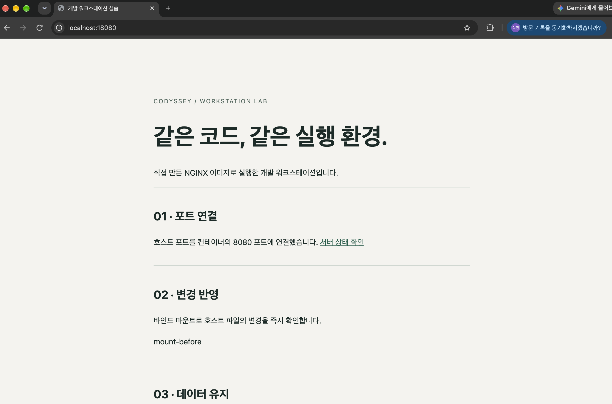
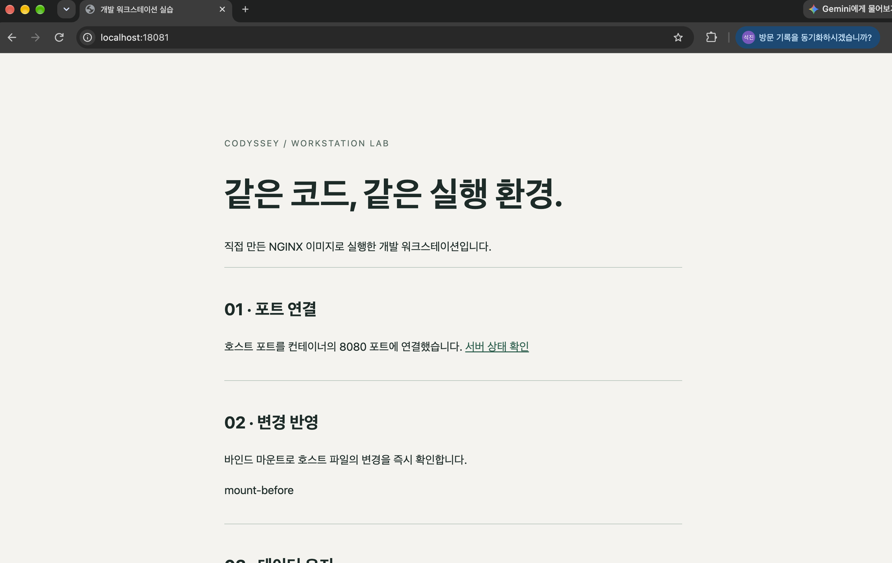

# 개발 워크스테이션 실습

NGINX 기반 커스텀 이미지를 만들고 18080·18081 포트에서 웹 페이지를 확인했다. 바인드 마운트로 파일 변경을 반영하고, 컨테이너 삭제 후 같은 볼륨에서 데이터를 다시 읽었다.

실습 기록은 [터미널 로그](evidence/manual-session.log), 브라우저 접속 결과는 [18080 화면](evidence/port-18080.png)과 [18081 화면](evidence/port-18081.png)에 담았다.

## 실행 방법

OrbStack을 켠 뒤 과제 폴더에서 실행한다.

```bash
cd /Users/hanseokjin/Desktop/project/codyssey/workstation-lab
docker compose up -d --build --wait
curl -f http://localhost:18080/health
```

`ok`가 나오면 브라우저에서 <http://localhost:18080>에 접속한다.

```bash
docker compose ps
docker compose logs --tail 20 web
docker compose down
```

위 명령은 순서대로 상태 확인, 최근 로그 확인, 서비스 종료에 사용한다.

## 수행 결과와 증거

| 항목 | 확인 결과 | 증거 |
|---|---|---|
| 터미널 조작 | 폴더 이동, 파일 생성·읽기·복사·이름변경·이동·삭제 실습 | [터미널 로그](evidence/manual-session.log) |
| 권한 | 파일 `600 → 644`, 디렉토리 `700 → 755` 확인 | [터미널 로그](evidence/manual-session.log), [권한 변경 로그](evidence/permissions.log) |
| Docker 점검 | 클라이언트·엔진 버전과 OrbStack 연결 확인 | [터미널 로그](evidence/manual-session.log) |
| 컨테이너 실행 | hello-world 출력, Ubuntu 내부 명령과 종료 상태 확인 | [터미널 로그](evidence/manual-session.log) |
| 이미지 빌드와 운영 | 커스텀 이미지 빌드, 목록·로그·자원 사용량·헬스체크 확인 | [터미널 로그](evidence/manual-session.log) |
| 포트 매핑 | 18080·18081에서 같은 웹 페이지 접속 | [18080 화면](evidence/port-18080.png), [18081 화면](evidence/port-18081.png) |
| 바인드 마운트 | 응답 문구가 `mount-before → mount-after`로 변경 | [터미널 로그](evidence/manual-session.log) |
| 볼륨 | 기존 컨테이너 삭제 후 `persistent-data` 재조회 | [터미널 로그](evidence/manual-session.log) |
| Compose | 서비스 실행·상태·로그·종료, 환경 변수로 포트 변경 실습 | [터미널 로그](evidence/manual-session.log) |
| Git 설정 | 제출용 설정 증거 보완 필요 | 아래 Git 설정 절 참고 |
| GitHub·VSCode 연동 | 이번 작업 범위에서 제외 | — |

로그에는 터미널 제어 문자가 포함되어 있다. 편집기에서 열거나 내려받아 결과를 확인한다. 아래 명령 블록은 실습을 다시 실행할 때 사용할 명령이며, 출력 발췌는 해당 로그를 기준으로 정리했다.

## 실행 환경

[터미널 로그](evidence/manual-session.log)에 기록된 버전이다.

| 항목 | 값 |
|---|---|
| OS | macOS 27.0.1 |
| Docker 클라이언트 | 29.4.0 |
| Docker 엔진 | 29.4.0 |
| 실행 환경 | OrbStack / aarch64 / overlay2 |
| Docker Compose | v5.1.2 |
| Git | 2.48.1 |

```text
ProductName: macOS
ProductVersion: 27.0.1
BuildVersion: 26A434
git version 2.48.1
Docker version 29.4.0, build 9d7ad9f
Server=29.4.0 OS=OrbStack Architecture=aarch64 Driver=overlay2
Docker Compose version v5.1.2
```

## 터미널 조작과 권한

파일은 `600`에서 `644`로 바뀌었다. 디렉토리는 대상 이름 오타로 `700`에 머물렀고, 추가 실습에서 올바른 이름으로 다시 실행해 `755`로 변경했다. 변경 전후는 [권한 변경 로그](evidence/permissions.log)에 기록했다.

```bash
cd practice
touch empty.txt
echo "Hello terminal" > original.txt
cat original.txt
cp original.txt copy.txt
mv copy.txt renamed.txt
mkdir -p archive
mv renamed.txt archive/
ls -la archive
rm archive/renamed.txt
rmdir archive
chmod 600 original.txt
chmod 700 permissions
ls -ld original.txt permissions
chmod 644 original.txt
chmod 755 permissions
ls -ld original.txt permissions
cd ..
```

[로그](evidence/manual-session.log)의 권한 출력에서 소유자와 시각을 생략한 결과:

```text
-rw-------@ ... original.txt
drwx------@ ... permissions

chmod: permisions: No such file or directory

-rw-r--r--@ ... original.txt
drwx------@ ... permissions
```

권한은 소유자·그룹·기타 사용자 순서로 읽는다. 읽기 `r=4`, 쓰기 `w=2`, 실행 `x=1`의 합으로 각 자리를 표현한다. `644`는 `rw-r--r--`, `755`는 `rwxr-xr-x`다. 디렉토리의 `x`는 내부 항목에 접근하는 권한이다.

절대 경로 `/Users/hanseokjin/Desktop/project/codyssey/workstation-lab`은 루트(`/`)부터 위치를 지정한다. 상대 경로 `site/index.html`은 현재 디렉토리를 기준으로 파일을 찾는다.

## 커스텀 이미지

`nginx:stable-alpine`에 웹 페이지와 서버 설정을 추가했다. [Dockerfile](Dockerfile)이 이미지를 만들고, [NGINX 설정](nginx/default.conf.template)이 서버 포트와 `/health` 응답을 정한다.

| 변경 | 목적 |
|---|---|
| `COPY site/` | [웹 페이지](site/index.html)를 이미지에 포함 |
| NGINX 설정 템플릿 | 환경 변수 `NGINX_PORT`로 내부 포트 지정 |
| `/health` | 서버 응답 확인 |
| `HEALTHCHECK` | 컨테이너 상태를 `healthy`로 판별 |
| OCI LABEL | 이미지 이름과 목적 표시 |

```bash
docker build -t codyssey-web:local .
docker images codyssey-web
```

빌드 과정과 이미지 목록은 [터미널 로그](evidence/manual-session.log)에 있다. 이미지는 실행 파일과 설정을 묶은 템플릿이고, 컨테이너는 그 이미지로 만든 실행 인스턴스다.

## 포트 매핑과 접속 결과

같은 이미지로 컨테이너 두 개를 실행하고 호스트 포트를 각각 18080·18081로 연결했다. 두 브라우저 화면에서 같은 페이지와 주소창의 포트를 확인할 수 있다.

```bash
docker run -d --name codyssey-web-a -p 127.0.0.1:18080:8080 codyssey-web:local
docker run -d --name codyssey-web-b -p 127.0.0.1:18081:8080 codyssey-web:local
curl -i http://localhost:18080/health
curl -i http://localhost:18081/health
```

`-p`는 `호스트주소:호스트포트:컨테이너포트` 순서다. 두 컨테이너 모두 내부 8080 포트를 쓰고, 호스트에서는 서로 다른 포트로 접근한다. `127.0.0.1`은 로컬 접속 주소다.

### 18080 접속



### 18081 접속



서버 운영 상태는 다음 명령으로 확인했다. 출력은 [터미널 로그](evidence/manual-session.log)에 있다.

```bash
docker ps -a
docker logs codyssey-web-a
docker stats --no-stream codyssey-web-a codyssey-web-b
docker inspect --format '{{.State.Health.Status}}' codyssey-web-a
```

헬스체크 결과:

```text
healthy
```

## 컨테이너 종료와 유지

Ubuntu의 주 프로세스인 Bash에서 `exit`를 입력하면 컨테이너가 종료됐다. `sleep infinity`를 주 프로세스로 실행한 컨테이너는 `exec`로 들어간 Bash를 종료한 뒤에도 실행 중이었다. 상태 비교는 [터미널 로그](evidence/manual-session.log)에 남겼다.

```bash
docker run -it --name codyssey-ubuntu ubuntu:24.04 bash
# 컨테이너 안에서 실행
ls -la
echo "Hello from Ubuntu"
exit
# Mac 터미널에서 상태 확인
docker ps -a
docker start -ai codyssey-ubuntu
# 다시 컨테이너 안에서 종료
exit
```

```bash
docker run -d --name codyssey-keep ubuntu:24.04 sleep infinity
docker exec -it codyssey-keep bash
# exec로 실행한 Bash 안에서 종료
exit
# Mac 터미널에서 실행 상태 확인
docker ps
```

`attach`는 주 프로세스의 입출력에 연결하고, `exec`는 별도 프로세스를 실행한다. 컨테이너 수명은 주 프로세스에 달려 있다.

## 바인드 마운트

호스트의 `site/index.html`을 수정하자 마운트한 서버의 응답이 바로 바뀌었다. 이미지에 복사한 파일을 쓰는 18080 서버의 응답은 `mount-before`로 남았다.

```bash
docker run -d --name codyssey-mount -p 127.0.0.1:18082:8080 -v "$(pwd)/site:/usr/share/nginx/html:ro" codyssey-web:local
curl -s http://localhost:18082/ | grep mount-before
sed -i '' 's/mount-before/mount-after/g' site/index.html
curl -s http://localhost:18082/ | grep mount-after
curl -s http://localhost:18080/ | grep mount-before
sed -i '' 's/mount-after/mount-before/g' site/index.html
```

[터미널 로그](evidence/manual-session.log)에 아래 순서로 응답이 기록되어 있다. 비교할 문구만 발췌했다.

```text
mount-before
mount-after
mount-before
```

바인드 마운트는 호스트 경로를 컨테이너에 연결한다. `:ro`는 컨테이너의 읽기 전용 접근을 뜻한다. 호스트에서 바꾼 파일은 연결된 경로에 즉시 반영된다.

## 볼륨 영속성

파일을 쓴 컨테이너를 삭제한 뒤 새 컨테이너에서 `persistent-data`를 읽었다. 데이터가 컨테이너의 쓰기 계층 대신 이름 있는 볼륨에 저장된 결과다.

```bash
docker volume create codyssey-practice-data
docker run -it --name codyssey-writer -v codyssey-practice-data:/data ubuntu:24.04 bash
# 컨테이너 안에서 실행
echo "persistent-data" > /data/message.txt
cat /data/message.txt
exit
# Mac 터미널에서 컨테이너 삭제 후 재조회
docker rm codyssey-writer
docker run --rm -v codyssey-practice-data:/data ubuntu:24.04 cat /data/message.txt
```

[터미널 로그](evidence/manual-session.log)의 삭제 전·후 조회 결과:

```text
persistent-data
persistent-data
```

## Compose와 환경 변수

[compose.yaml](compose.yaml)에 빌드, 포트, 환경 변수, 바인드 마운트를 묶었다. 긴 `docker run` 명령 대신 이 파일로 같은 서비스를 실행한다.

```bash
docker compose up -d --build --wait
docker compose ps
docker compose logs --tail 20 web
docker compose down
HOST_PORT=18083 NGINX_PORT=9090 docker compose up -d --wait
curl http://localhost:18083/health
HOST_PORT=18083 NGINX_PORT=9090 docker compose down
```

[터미널 로그](evidence/manual-session.log)에서 기본 포트의 `healthy` 상태와 변경한 포트의 `ok` 응답을 확인할 수 있다. `HOST_PORT`는 호스트 포트, `NGINX_PORT`는 컨테이너 내부 포트를 정한다.

## Git 설정

Git은 로컬 변경 이력을 관리하고 GitHub는 원격 저장소와 협업 기능을 제공한다. 이번 작업의 범위는 로컬 Git 설정까지다.

현재 `evidence`에는 Git 설정 결과 파일이 없다. 다음 명령으로 설정한 뒤 이름과 이메일을 마스킹한 결과를 제출 증거로 추가한다.

```bash
git init -b main
git config --local user.name "본인 이름"
git config --local user.email "본인 이메일"
git config --local init.defaultBranch main
git config --local --list | sed -E 's/^(user\.(name|email))=.*/\1=[REDACTED]/' > evidence/manual-git.log
```

## 트러블슈팅

실제 [터미널 로그](evidence/manual-session.log)에 남은 경로 오류 두 건이다.

### 디렉토리 이동 실패

`cd`에 `practice` 대신 `pratice`를 입력해 이동에 실패했다.

```text
cd: no such file or directory: pratice
```

폴더명 오타를 의심하고 이름을 확인한 뒤 `practice`로 이동했다. 이후 로그에서 올바른 현재 경로를 확인했다.

```bash
ls -la
cd practice
pwd
```

### 디렉토리 권한 변경 실패

`chmod` 대상에 `permissions` 대신 `permisions`를 입력했다. 파일은 `644`로 바뀌었지만 디렉토리는 `700`으로 남았다.

```text
chmod: permisions: No such file or directory
```

원인은 대상 이름 오타다. 아래 명령으로 다시 실행해 디렉토리를 `755`로 바꿨다. [추가 검증 로그](evidence/permissions.log)에서 변경 전 `drwx------`과 변경 후 `drwxr-xr-x`를 확인할 수 있다.

```bash
chmod 755 practice/permissions
ls -ld practice/permissions
```

## 파일 구성

- [Dockerfile](Dockerfile): 커스텀 이미지 빌드
- [site/index.html](site/index.html): 웹 페이지
- [nginx/default.conf.template](nginx/default.conf.template): 서버 설정
- [compose.yaml](compose.yaml): 서비스 실행 설정
- [evidence](evidence/): 터미널 로그와 두 포트의 접속 사진
